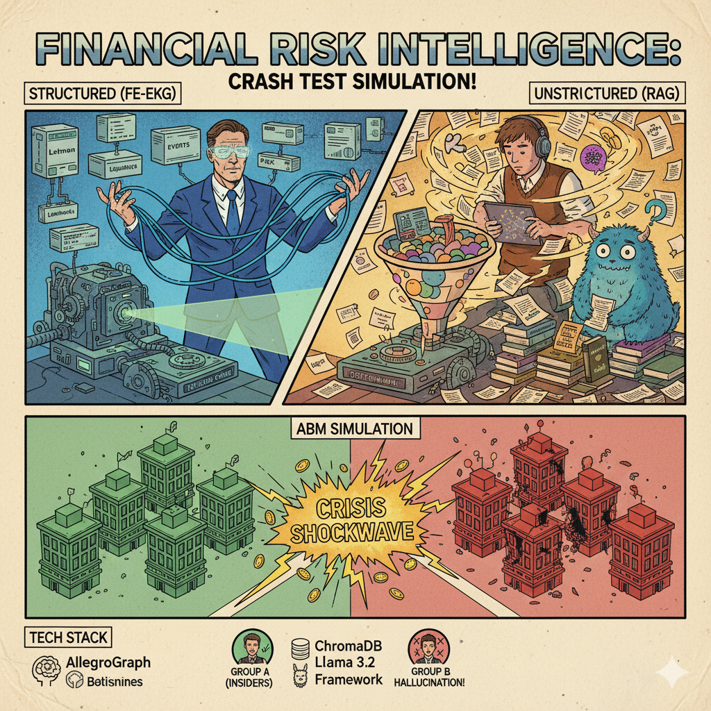

# Financial Risk Intelligence

Comparing structured (Knowledge Graph) vs unstructured (RAG) approaches to financial risk intelligence in multi-agent crisis simulations.




## Research Question

**How does information structure affect crisis decision-making?**

We compare two approaches to financial risk intelligence in an agent-based model:

| Approach | Method | Strengths |
|----------|--------|-----------|
| **FE-EKG (Structured)** | Explicit causal chains, SPARQL queries, rule-based risk propagation | High precision, traceability |
| **RAG (Unstructured)** | Semantic similarity over documents, LLM-based interpretation | Flexibility, coverage |

## Key Contribution

We study how information quality affects both **individual agent decisions** and **system-level stability** by comparing:
- **Group A (Insiders):** RAG-enabled agents with historical financial context
- **Group B (Noise Traders):** Uninformed SLM agents prone to hallucination

## Hypotheses

- **H1:** RAG-enabled agents make more contextually appropriate decisions across market regimes
- **H2:** Information asymmetry manifests as differences in decision consistency, risk timing, and survival
- **H3:** RAG retrieval quality correlates with agent decision quality

## Architecture

```
┌─────────────────────────────────────────────────────────┐
│                    ABM Simulation                       │
│  ┌─────────────┐              ┌─────────────┐           │
│  │  Group A    │              │  Group B    │           │
│  │  (RAG)      │              │  (No RAG)   │           │
│  └──────┬──────┘              └──────┬──────┘           │
│         │                            │                  │
│         ▼                            ▼                  │
│  ┌─────────────┐              ┌─────────────┐           │
│  │ Historical  │              │ SLM Only    │           │
│  │ Context     │              │ (Halluci-   │           │
│  │ (442K docs) │              │  nation)    │           │
│  └─────────────┘              └─────────────┘           │
└─────────────────────────────────────────────────────────┘

Knowledge Graph (FE-EKG)          RAG Pipeline
┌─────────────────────┐     ┌─────────────────────┐
│ Risk Layer          │     │ ChromaDB            │
│ [Liquidity]→[Credit]│     │ 442K chunks         │
│        ↑            │     │ BGE embeddings      │
│ Event Layer         │     │ Reranker            │
│ [Default]→[Downgrade│     │                     │
│        ↑            │     │ Sources:            │
│ Entity Layer        │     │ - JPM Weekly        │
│ [Lehman]→[Morgan]   │     │ - BIS Reports       │
└─────────────────────┘     │ - FT Archive        │
                            │ - FCIC Report       │
                            └─────────────────────┘
```

## Tech Stack

- **Knowledge Graph:** AllegroGraph (RDF/SPARQL), 59K triples
- **RAG:** ChromaDB + BGE embeddings + Reranker
- **ABM:** Mesa framework
- **SLM:** Llama 3.2 1B Instruct
- **API:** Flask + CORS
- **Data:** 4,000 Capital IQ events (2007-2009 Lehman crisis)

## Quick Start

### 1. Setup

```bash
python -m venv venv
source venv/bin/activate
pip install -r requirements.txt           # KG toolkit + API
pip install -r requirements-research.txt  # + RAG / SLM / ABM experiments
pip install -r requirements-dev.txt       # tests + lint
```

### 2. Configure

```bash
cp .env.example .env   # then set AG_URL, AG_USER, AG_PASS
```

### 3. Run Experiment

```bash
source .env && export PYTHONPATH=. && export TOKENIZERS_PARALLELISM=false
python run_experiment.py --liquidity-factor 0.15
```

### 4. Run API

```bash
FLASK_DEBUG=1 python -m api.app               # development, http://127.0.0.1:5001
gunicorn -c gunicorn.conf.py api.wsgi:app      # production
docker build -t feekg-api . && docker run -p 5001:5001 --env-file .env feekg-api
```

See [api/README.md](api/README.md) for configuration and all endpoints.

### 5. Test

```bash
pytest && ruff check .
```

## Project Structure

```
├── abm/              # Agent-based model (Mesa)
│   ├── agents.py     # BankAgent with use_rag flag
│   └── model.py      # CrisisModel simulation
├── rag/              # RAG pipeline
│   ├── retriever.py  # ChromaDB retrieval
│   ├── reranker.py   # BGE reranker
│   └── evaluation.py # RAG metrics
├── slm/              # Small language model
│   └── llama_client.py
├── evolution/        # 6 event evolution algorithms
├── query/            # SPARQL queries
├── api/              # Flask REST API
├── config/           # Configuration
└── data/             # Capital IQ data
```

## Experiment Configuration

| Parameter | Value |
|-----------|-------|
| Simulation length | 52 weeks |
| Banks | 10 (5 RAG, 5 non-RAG) |
| Initial capital | 100B each |
| Shock week | Week 5 (testing) |
| Pre-shock volatility | 10% |
| Post-shock volatility | 80% |

### Parameter Sweep

| Run | Liquidity Factor | Stress Level |
|-----|------------------|--------------|
| 1 | 0.30 | Mild |
| 2 | 0.20 | Moderate |
| 3 | 0.15 | Significant |
| 4 | 0.10 | Severe |

## Evaluation Metrics

| Metric | Description |
|--------|-------------|
| Survival Rate | % of each group alive at end |
| Decision Distribution | DEFENSIVE vs MAINTAIN counts |
| Capital Preservation | Final capital comparison |
| Response Quality | Source citations vs hallucinations |

## RAG Dataset

| Source | Files | Coverage |
|--------|-------|----------|
| JPM Weekly (2002-2009) | 366 | Credit, liquidity, market risks |
| BIS Annual (1931-2024) | 94 | Systemic risk, banking stability |
| BIS Quarterly (1997-2024) | 114 | Cross-border risks, derivatives |
| FT Archive | 2,626 | Event-driven risks, sentiment |
| FCIC Report | 1 | Comprehensive crisis analysis |

**Total:** 3,207 files, 442K chunks

## Knowledge Graph (FE-EKG)

Based on Liu et al. (2024) "Risk identification and management through knowledge Association"

**Three-layer structure:**
- **Entity Layer:** 22 financial institutions
- **Event Layer:** 4,000 events with 6 evolution algorithms
- **Risk Layer:** Risk types and transitions

**Evolution Methods:**
1. Temporal Correlation (TCDI formula)
2. Entity Overlap (Jaccard similarity)
3. Semantic Similarity
4. Topic Relevance
5. Event Type Causality
6. Emotional Consistency

## API Endpoints

| Endpoint | Description |
|----------|-------------|
| `GET /health`, `GET /ready` | Liveness / readiness probes |
| `GET /api/entities` | All entities (22) |
| `GET /api/events` | All events (4,000) |
| `GET /api/evolution/links` | Evolution relationships |
| `GET /api/graph/data` | Graph visualization data |

## Future Phases

- **Phase 3:** Inter-bank contagion mechanism
- **Phase 4:** GraphRAG / KG-GNN hybrid
- **Phase 5:** Comparative evaluation (KG vs RAG vs Hybrid)

## Documentation

- [CLAUDE.md](CLAUDE.md) - Developer guide
- [docs/PROJECT_OVERVIEW.md](docs/PROJECT_OVERVIEW.md) - Project overview
- [rag/EVALUATION_PLAN.md](rag/EVALUATION_PLAN.md) - RAG evaluation plan

## Frontend

[feekg-frontend](https://github.com/JunjieAraoXiong/feekg-frontend) - Next.js visualization app

## References

### Core Research Papers

**Knowledge Graph & Risk Management**
- Liu et al. (2024) - "Risk identification and management through knowledge Association: A financial event evolution knowledge graph approach"

**Information Asymmetry & Market Microstructure**
- Akerlof (1970) - "The Market for Lemons: Quality Uncertainty and the Market Mechanism"
- Grossman & Stiglitz (1980) - "On the Impossibility of Informationally Efficient Markets"
- Kyle (1985) - "Continuous Auctions and Insider Trading"

**Financial Contagion & Systemic Risk**
- Allen & Gale (2000) - "Financial Contagion"
- Battiston et al. (2012) - "DebtRank: Too Central to Fail?"
- Acemoglu et al. (2015) - "Systemic Risk and Stability in Financial Networks"

**Agent-Based Modeling in Finance**
- LeBaron (2006) - "Agent-based Computational Finance"
- Farmer & Foley (2009) - "The economy needs agent-based modelling"
- Bookstaber (2017) - "The End of Theory: Financial Crises, the Failure of Economics, and the Sweep of Human Interaction"

**2008 Financial Crisis**
- Brunnermeier (2009) - "Deciphering the Liquidity and Credit Crunch 2007-2008"
- Financial Crisis Inquiry Commission (2011) - "The Financial Crisis Inquiry Report"
- Gorton (2010) - "Slapped by the Invisible Hand: The Panic of 2007"

**RAG & LLM Methodology**
- Lewis et al. (2020) - "Retrieval-Augmented Generation for Knowledge-Intensive NLP Tasks"
- Gao et al. (2023) - "Retrieval-Augmented Generation for Large Language Models: A Survey"

### Technologies

- [AllegroGraph](https://allegrograph.com/) - RDF triplestore
- [Mesa ABM](https://mesa.readthedocs.io/) - Agent-based modeling framework
- [ChromaDB](https://www.trychroma.com/) - Vector database
- [BGE Embeddings](https://huggingface.co/BAAI/bge-large-en-v1.5) - Text embeddings
- [Llama 3.2](https://llama.meta.com/) - Small language model

## License

MIT - Research and educational purposes.
